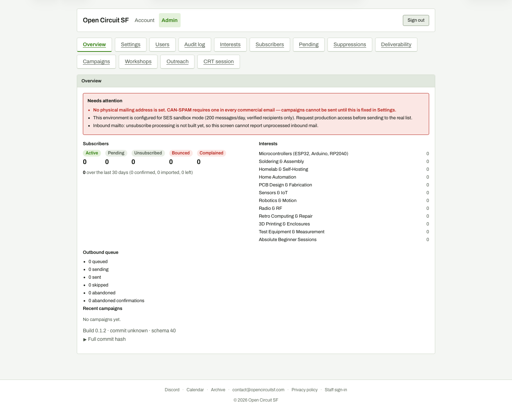

# Admin overview (1440 wide, full page)

**Steps to reach it:** Open http://localhost:18080/admin (auto signed-in by DEV_ADMIN_LOGIN).

**What the admin is trying to do:** Find where the new outreach work lives.

**Observations (candid):**

- Thirteen top tabs in two wrapped rows; 'Outreach' sits next to 'Workshops' and 'CRT session' with nothing saying it is about social posting or flyers.
- The first thing shown is a red 'Needs attention' box (no mailing address, SES sandbox, inbound mailto not built). None of it relates to outreach. A new outreach user gets no hint of what to do next.
- The page is a long scroll of mailing-list stats (all zeros here) before anything actionable.
