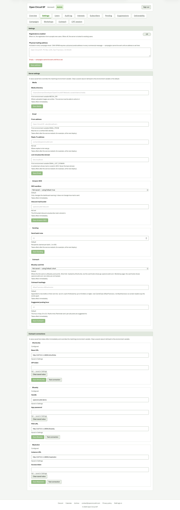

# Settings, whole page (4077 px tall)

**Steps to reach it:** Top nav, Settings.

**What the admin is trying to do:** Find where to connect Bluesky, Mastodon and ShortLinks.

**Observations (candid):**

- Outreach connections is the very last panel, roughly 3,000 px down. Nothing at the top of the page or in the nav links to it.
- Six stacked sections with different save rules: some say 'Takes effect immediately', others 'after the service restarts (for example, at the next deploy)'. An admin cannot tell which is which without reading every caption.
- Every Save button is disabled (pale green) until a change; it is hard to tell disabled from primary at a glance.
- Outreach settings are split across two panels: 'Outreach' under Server settings (card link, hashtags, posting hour) and 'Outreach connections' (credentials). Same word, two places.
- Secret fields show an empty box with 'Set - saved in Settings' underneath, which reads as though the field is blank. Only a small 'Clear saved value' button hints it is filled.
