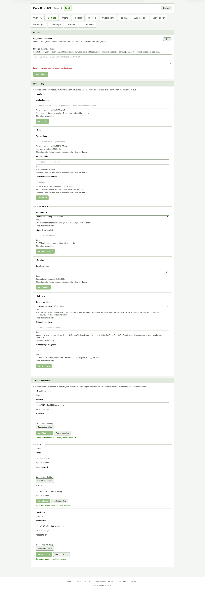

# Settings: Test connection succeeded on all three (full page)

**Steps to reach it:** On Settings, click Test connection under ShortLinks, Bluesky, Mastodon.

**What the admin is trying to do:** Confirm credentials work.

**Observations (candid):**

- Success appears as small green text under each button: 'Connected to ShortLinks as ...', 'Signed in to Bluesky as @...', 'Signed in to Mastodon as @...'. Clear enough, but it is easy to miss below the fold, and the button label flips to 'Testing...' with no spinner.
- The text stays after you edit fields, so a stale 'Signed in' can sit next to an unsaved change (see 04).
