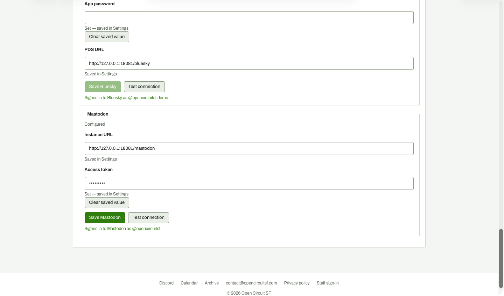

# Settings: typed a bad token but did not save, Test connection

**Steps to reach it:** Type bad-token into Mastodon Access token (viewport shot after clicking Test connection without saving).

**What the admin is trying to do:** Check whether a new token works before saving it.

**Observations (candid):**

- Test connection tests the SAVED credentials, not the box you just typed in. It reports 'Signed in to Mastodon as @opencircuitsf' while a different token sits unsaved in the field. This is actively misleading.
- The field is a password input so the typed value shows as dots; Save Mastodon is enabled (dark green) but nothing warns that Test ignores it.
- Nothing says 'tested the saved value'.
