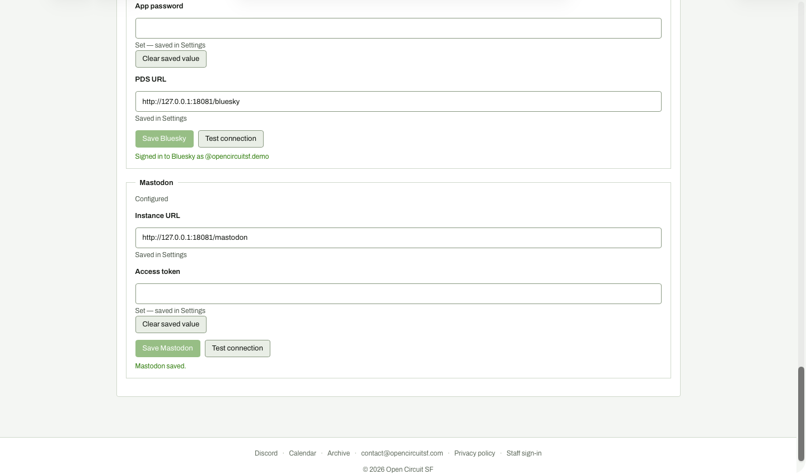

# Settings: bad Mastodon token saved

**Steps to reach it:** Click Save Mastodon after typing bad-token.

**What the admin is trying to do:** Persist the token.

**Observations (candid):**

- No confirmation that the save succeeded: the button just goes pale and the field empties. The only evidence is 'Set - saved in Settings', which was already there before.
- Saving a credential that has not been tested is the default path. There is no 'Save and test'.
