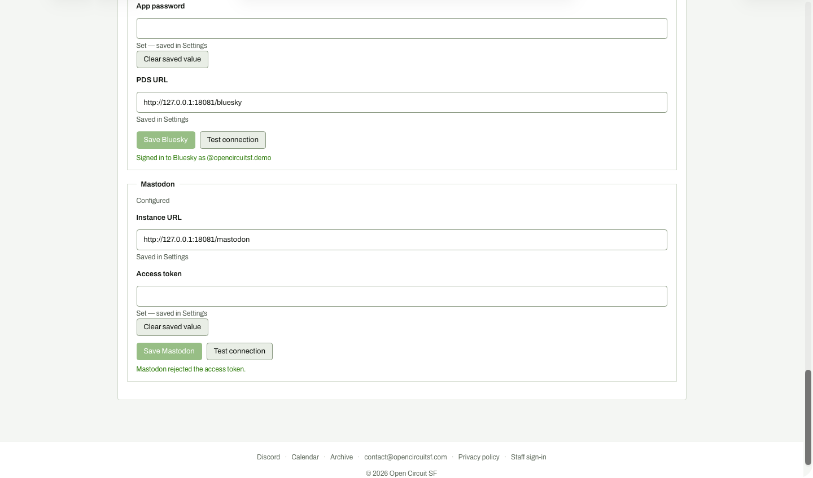

# Settings: Test connection failure

**Steps to reach it:** Click Test connection for Mastodon after saving bad-token.

**What the admin is trying to do:** See why the connection fails.

**Observations (candid):**

- The failure message 'Mastodon rejected the access token.' is rendered in the SAME GREEN as success. Colour alone says everything is fine; you have to read it.
- No guidance on what to do (create a new token, scopes needed, where to find it).
- Mastodon Configured badge above still says 'Configured' even though the token is rejected.
