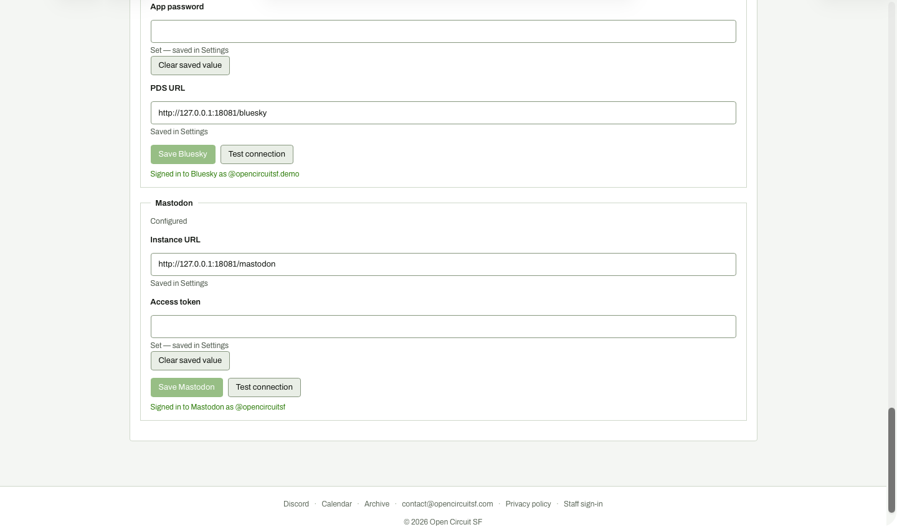

# Settings: working token restored

**Steps to reach it:** Fill demo-token, Save Mastodon, Test connection.

**What the admin is trying to do:** Recover from the failure.

**Observations (candid):**

- Back to green 'Signed in'. Works, but again no explicit saved message.
