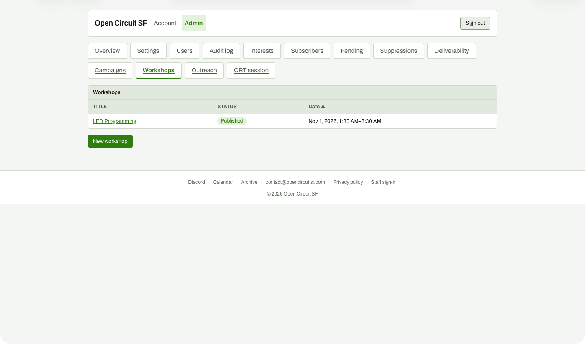

# Workshops list

**Steps to reach it:** Top nav, Workshops.

**What the admin is trying to do:** Open LED Programming to manage its outreach.

**Observations (candid):**

- Only a table (Title, Status, Date) with one sortable header. No outreach column or badge, so you cannot tell which workshops have outreach started or need it.
- Time shows 'Nov 1, 2026, 1:30 AM-3:30 AM'. The workshop is a 6:30 PM Pacific event; the admin UI renders in the browser's timezone (the guest VM is UTC) while posts and flyers render Pacific. See README timezone note, but a real admin on a laptop elsewhere would see the same inconsistency.
