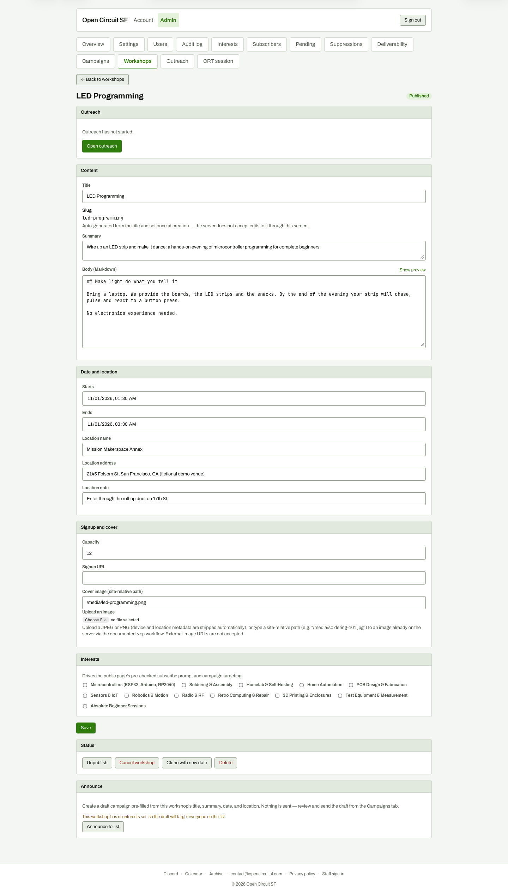

# Workshop editor with Outreach summary

**Steps to reach it:** Workshops, click LED Programming.

**What the admin is trying to do:** Reach the outreach for this workshop.

**Observations (candid):**

- Outreach panel is first, says 'Outreach has not started.' with an 'Open outreach' button. Good pointer, but 'Open' for something that has not started is a misnomer: the next screen is where you Start it.
- The form is long (about 2,500 px). Save sits far below the Content fields it commits; Announce to list is another unrelated 'announce' (email) at the bottom, next to the social Announce wave. Two different 'Announce' concepts.
- Interests are all unchecked but the checkboxes read value 'on'; harmless but the 'Announce' warning says no interests set.
- Cover image is a typed path; in this demo it 404s (known demo limit).
