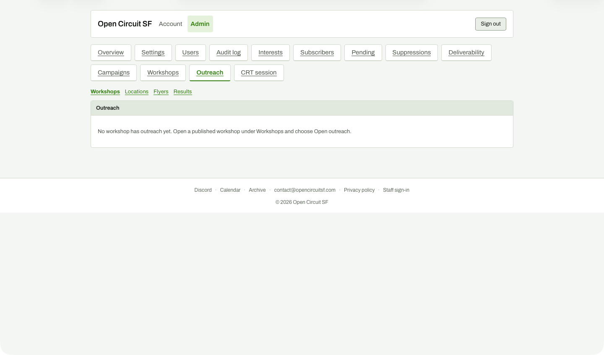

# Outreach list (Workshops sub-tab) before any outreach started

**Steps to reach it:** Top nav, Outreach.

**What the admin is trying to do:** See all workshops and start outreach.

**Observations (candid):**

- Empty state: 'No workshop has outreach yet. Open a published workshop under Workshops and choose Open outreach.' It sends you away to another tab instead of listing eligible workshops with a Start button here.
- The sub-nav item 'Workshops' under the Outreach tab and the top-level 'Workshops' tab share a name; confusing which is which.
- The page occupies the top third of the window and the footer floats mid-screen (page does not fill the viewport).
