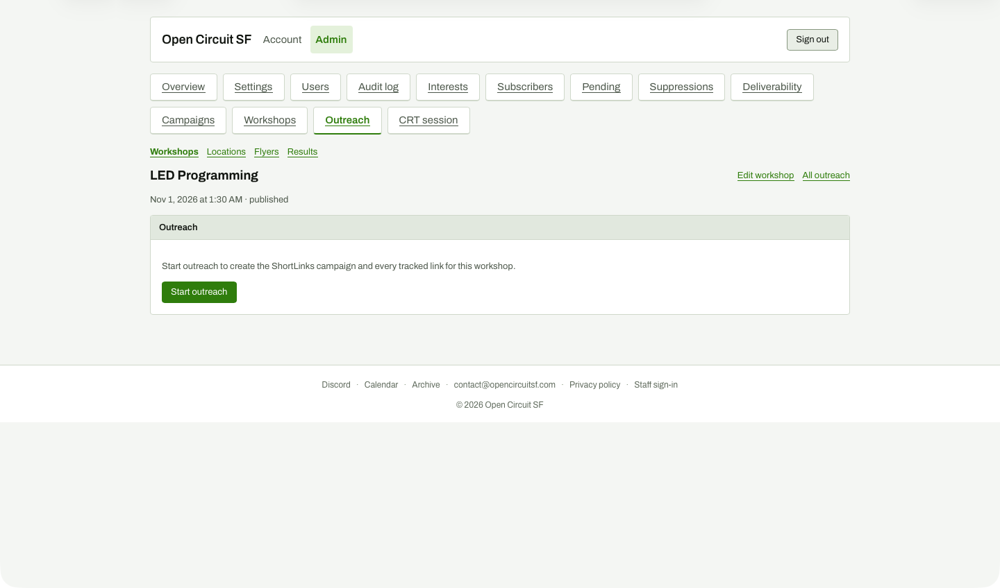

# Workshop outreach, before Start

**Steps to reach it:** Open #/outreach?view=workshop&workshop=1 (via Open outreach).

**What the admin is trying to do:** Start outreach.

**Observations (candid):**

- One sentence and one button: 'Start outreach to create the ShortLinks campaign and every tracked link for this workshop.' It does not say what posts will be made, whether anything is published, how many links (19), or that it contacts ShortLinks.
- 'ShortLinks campaign' and 'tracked link' are jargon a volunteer organiser will not know.
