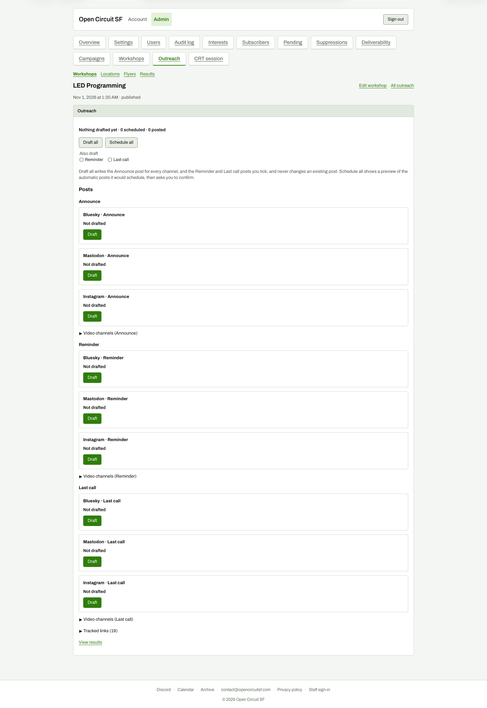

# Workshop outreach after Start

**Steps to reach it:** Click Start outreach.

**What the admin is trying to do:** Draft posts.

**Observations (candid):**

- No link report or confirmation appears after Start. The page just swaps to a 3x3 grid of 'Not drafted' cards (Announce, Reminder, Last call x Bluesky, Mastodon, Instagram) with a hidden 'Video channels' disclosure per wave. The 19 created links are only visible in a collapsed 'Tracked links (19)' at the bottom.
- Page is 2,100 px tall with nine near-identical cards each holding one Draft button. Drafting nine times is tedious; 'Draft all' is easy to miss at top.
- Status line 'Nothing drafted yet - 0 scheduled - 0 posted' is bold and terse.
