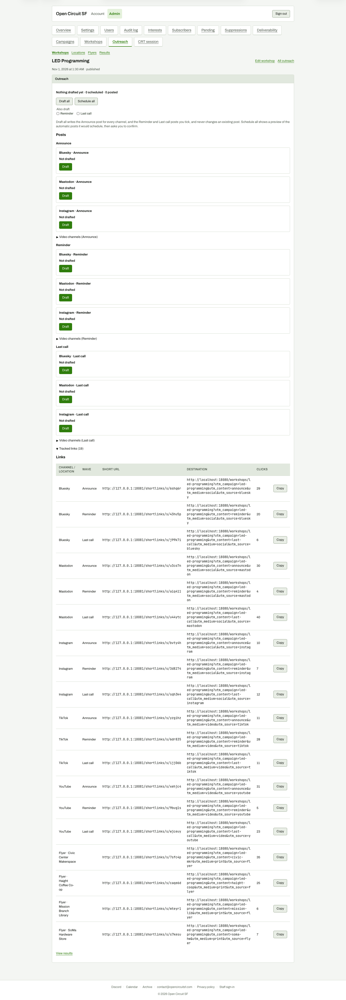

# Tracked links expanded

**Steps to reach it:** Click the 'Tracked links (19)' disclosure.

**What the admin is trying to do:** Check the short links and what they point to.

**Observations (candid):**

- Dense 19-row table of full destination URLs with UTM parameters wrapping mid-word. Not scannable.
- Click counts are already non-zero (29, 20, 40...) before anything was posted. This is demo mock data, but it looks like a bug; the same numbers show up later as '340 clicks since outreach started'.
- Short URLs point at the mock (127.0.0.1:18081) - not clickable, no per-row Open.
