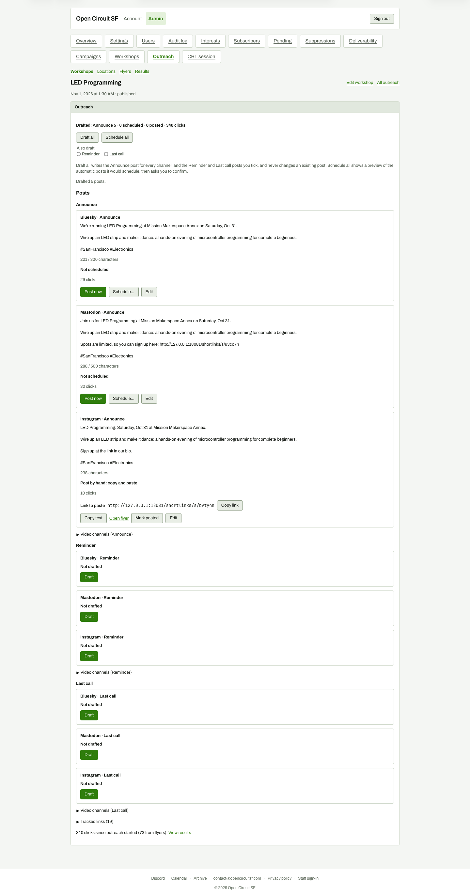

# After Draft all with Reminder and Last call unticked

**Steps to reach it:** Click Draft all with the 'Also draft' boxes unticked.

**What the admin is trying to do:** Get Announce drafts for every channel.

**Observations (candid):**

- Message 'Drafted 5 posts.' appears in a small line under the explanatory paragraph, far from the cards. Summary line says 'Drafted: Announce 5' and the 5 includes two video channels hidden inside a collapsed disclosure; only 3 cards are visible.
- Post copy says 'Saturday, Oct 31' while the screen header says 'Nov 1, 2026 at 1:30 AM' (Pacific vs browser timezone).
- The Bluesky post contains no link at all (link card via the post), while Mastodon pastes a raw short URL. Admin cannot see what the Bluesky card will link to without opening the editor.
- 'Also draft: Reminder, Last call' checkboxes sit under the button with a faint label; you have to read the paragraph below to learn they matter.
