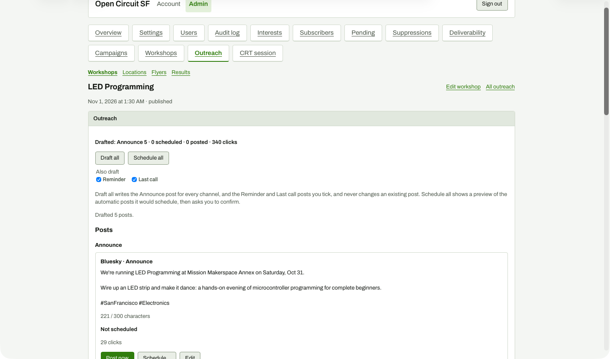

# Reminder and Last call ticked

**Steps to reach it:** Tick both 'Also draft' boxes.

**What the admin is trying to do:** Draft all waves at once.

**Observations (candid):**

- Checkbox state is unrelated to anything visible until pressed. 'Drafted 5 posts.' from the previous run is still on screen, so it is unclear what the stale message refers to.
