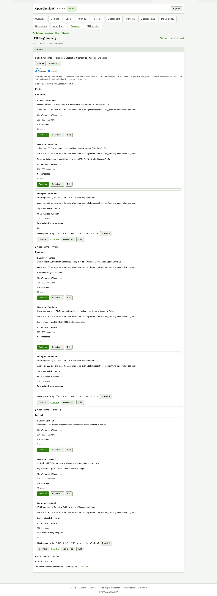

# After Draft all with both boxes ticked (full page, 3,800 px)

**Steps to reach it:** Click Draft all.

**What the admin is trying to do:** Review all drafts.

**Observations (candid):**

- Message reads 'Drafted 10 posts; 5 existing posts were left alone.' Accurate, but the 'left alone' posts are not marked as such.
- All cards equal weight; no per-wave grouping beyond a small bold label; the page is very long.
- Reminder/Last call copy is clearly templated ('One week out ...', 'Tomorrow ...').
