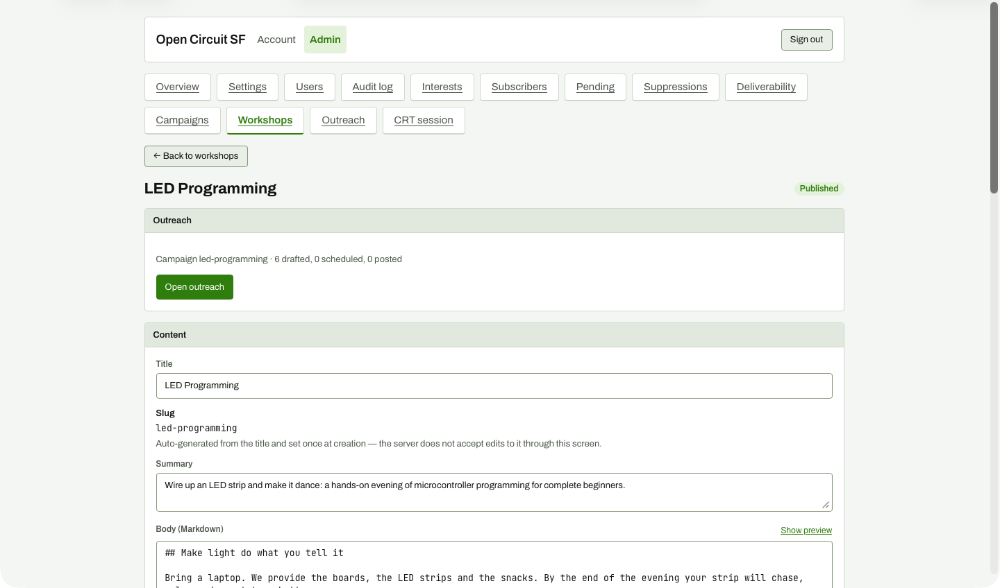

# Workshop editor outreach summary after drafting

**Steps to reach it:** Click 'Edit workshop' from the outreach page (my intended click was a card's Edit button; the text match hit this link).

**What the admin is trying to do:** Return to the workshop.

**Observations (candid):**

- Summary says 'Campaign led-programming - 6 drafted, 0 scheduled, 0 posted' although 15 posts are drafted (5 channels x 3 waves) per the outreach page. The numbers disagree.
- The summary exposes the internal campaign slug.
