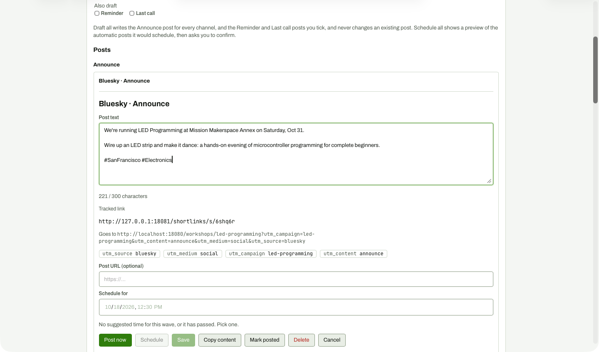

# Post card editor open (Bluesky Announce)

**Steps to reach it:** On the outreach page, click Edit on the Bluesky Announce card.

**What the admin is trying to do:** Tweak the wording.

**Observations (candid):**

- Card title is repeated ('Bluesky - Announce' as card heading and again as editor heading).
- Seven actions in one row: Post now, Schedule, Save, Copy content, Mark posted, Delete, Cancel. Post now (the most consequential) is the most prominent button, directly next to Save.
- 'Schedule for' shows 12:30 PM today pre-filled with a grey 'No suggested time for this wave, or it has passed. Pick one.'
- Tracked link panel and UTM chips are useful but the post text does not include the link, so the admin cannot tell how the link reaches the post (Bluesky card link setting lives on the Settings page).
