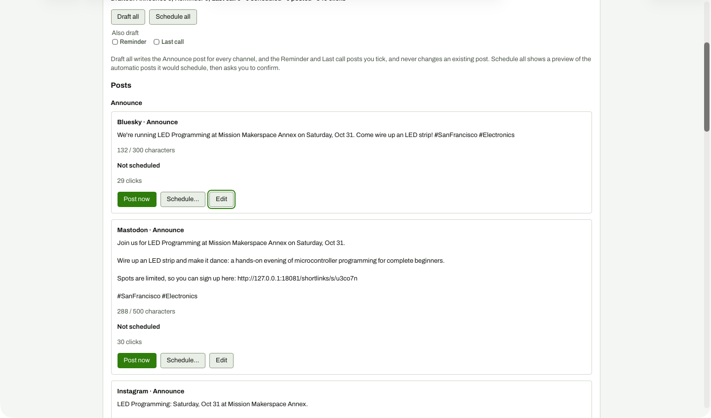

# Card after saving the edit

**Steps to reach it:** Change the text, click Save.

**What the admin is trying to do:** Confirm the edit stuck.

**Observations (candid):**

- The editor closes and the card shows the new text (132 / 300 characters). No toast or 'Saved' confirmation; the scroll position jumps so the card is at the top of the viewport.
- Edit button keeps focus ring - fine.
