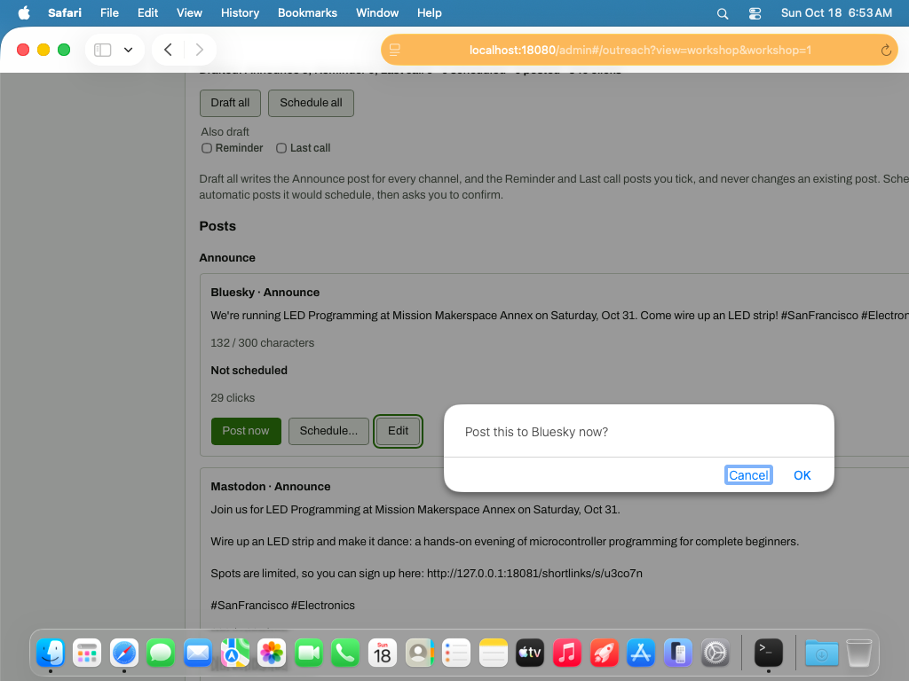

# Post now confirm dialog (native browser confirm)

**Steps to reach it:** Click Post now on Bluesky Announce. Screenshot taken with the guest's screencapture because Safari's WebDriver hangs while a native dialog is open (1024x768 guest screen, not the 1440 window).

**What the admin is trying to do:** Publish the post.

**Observations (candid):**

- It is a native browser confirm() reading only 'Post this to Bluesky now?'. It does not show the text, the account (@opencircuitsf.demo) or that it is public and irreversible.
- Cancel is the default-focus button, OK is far right: fine, but the dialog looks like an OS alert, not part of the product (inconsistent with the in-page Schedule all modal).
- Dialog blocks all automation and screen readers handle it inconsistently.
- Note: I auto-accepted the same dialog in later steps by overriding window.confirm in the page; the Mastodon dialog was not photographed.
