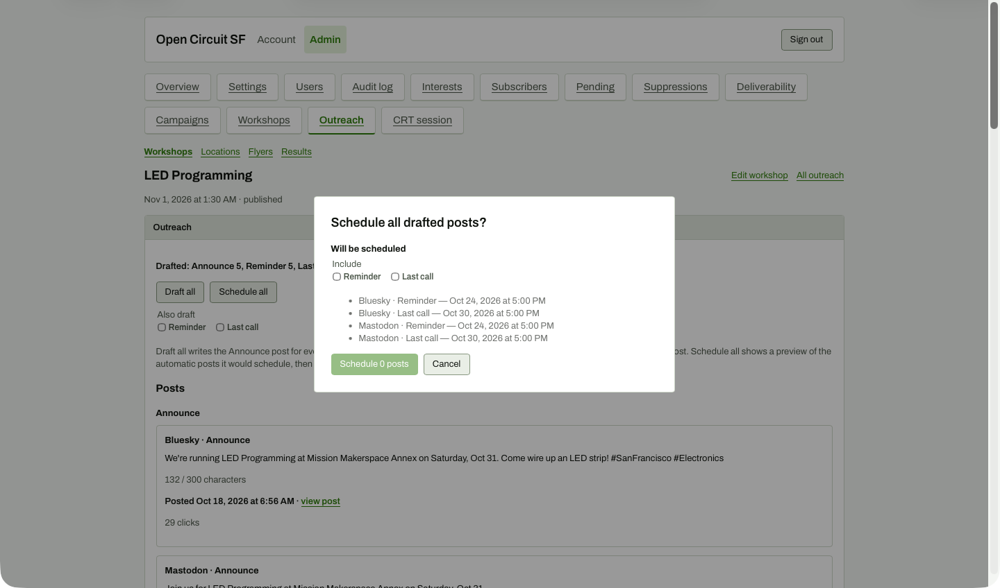

# Schedule all modal (default state)

**Steps to reach it:** Click Schedule all (viewport shot).

**What the admin is trying to do:** Schedule the Reminder and Last call posts for me.

**Observations (candid):**

- The modal is headed 'Schedule all drafted posts?' and lists four posts under 'Will be scheduled' with dates, but the button says 'Schedule 0 posts' and is disabled because its own Reminder/Last call checkboxes start unticked. The list contradicts the button.
- It duplicates the 'Also draft' Reminder/Last call checkboxes from the page with a different label ('Include'). Two sets of the same toggles.
- Instagram/TikTok/YouTube are silently excluded (manual channels); the modal does not say so.
- Times are fixed at 5:00 PM and cannot be edited here.
