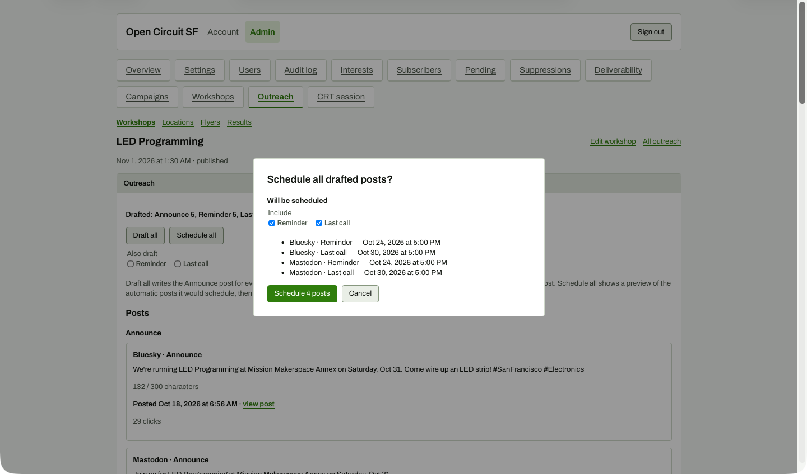

# Schedule all with boxes ticked

**Steps to reach it:** Tick Reminder and Last call in the modal.

**What the admin is trying to do:** Enable scheduling.

**Observations (candid):**

- Button becomes 'Schedule 4 posts'. Cancel next to it. Works, but see 25: the default is a dead end.
