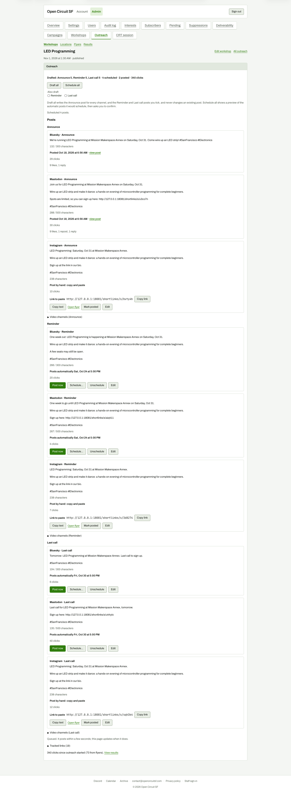

# After scheduling (full page)

**Steps to reach it:** Click Schedule 4 posts.

**What the admin is trying to do:** Confirm everything is queued.

**Observations (candid):**

- 'Scheduled 4 posts.' appears in a small line near the top; cards now say 'Posts automatically Sat, Oct 24 at 5:00 PM' with Post now / Schedule... / Unschedule / Edit.
- A stale 'Queued. It posts within a few seconds; this page updates when it does.' line from the earlier Post now still sits near the bottom of the page.
- Engagement ('9 likes, 1 reply') already appears under the posted cards.
