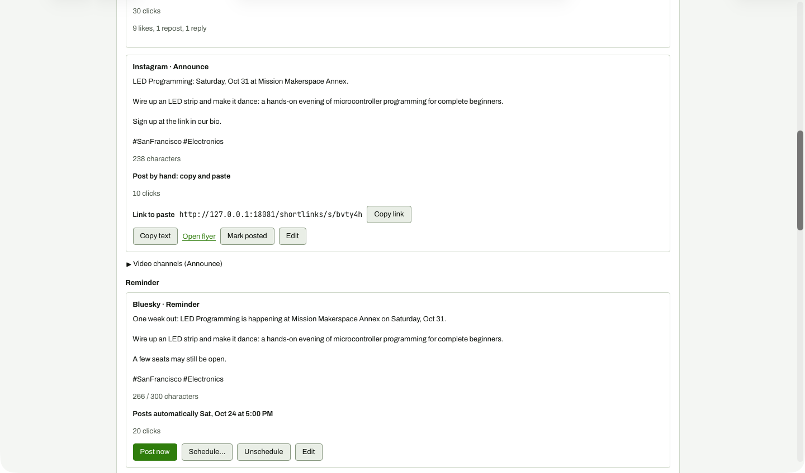

# Manual channel (Instagram) Copy text

**Steps to reach it:** Click Copy text on the Instagram Announce card.

**What the admin is trying to do:** Copy the caption to paste into Instagram.

**Observations (candid):**

- No visible feedback at all after clicking (no 'Copied', no change). Whether it worked in Safari I cannot tell; the clipboard may be blocked in automation, but a real user also gets zero confirmation.
- 'Copy link' and 'Copy text' are separate buttons, so posting by hand needs two copies and two pastes; the text says 'Sign up at the link in our bio' while the link sits in the card, a mismatch for Instagram where links are not clickable in captions.
