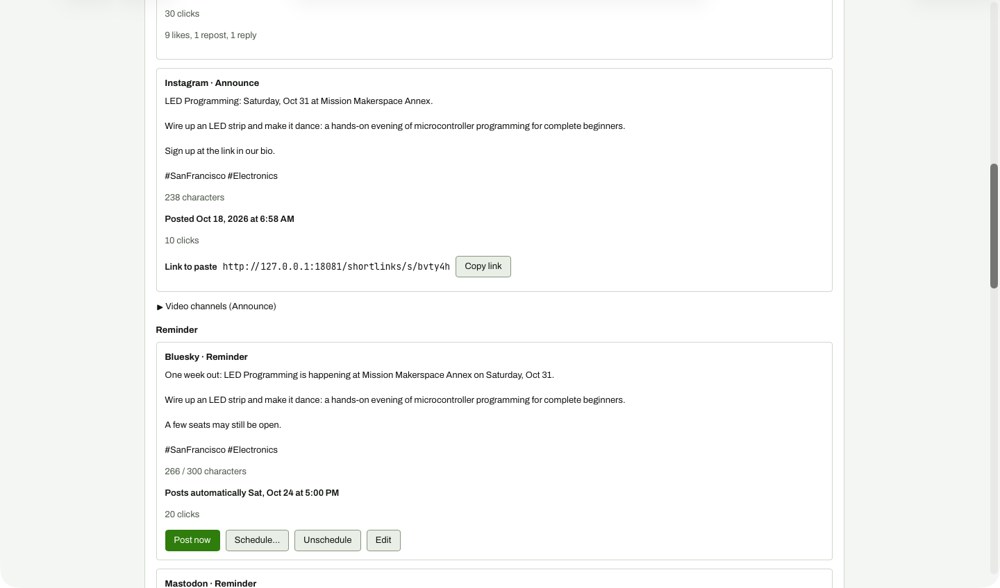

# Manual channel after Mark posted

**Steps to reach it:** Click Mark posted on Instagram Announce.

**What the admin is trying to do:** Record that I posted it by hand.

**Observations (candid):**

- One click, no confirmation, no URL or time prompt (it records 'now'), and no undo. Copy text, Open flyer and Edit buttons vanish immediately, so a mis-click cannot be fixed.
- 'Marked as posted.' appears in the small status area at the top of the page, off-screen.
- 'Open flyer' on these cards goes to the Flyers list, which is empty at this point (see 33).
