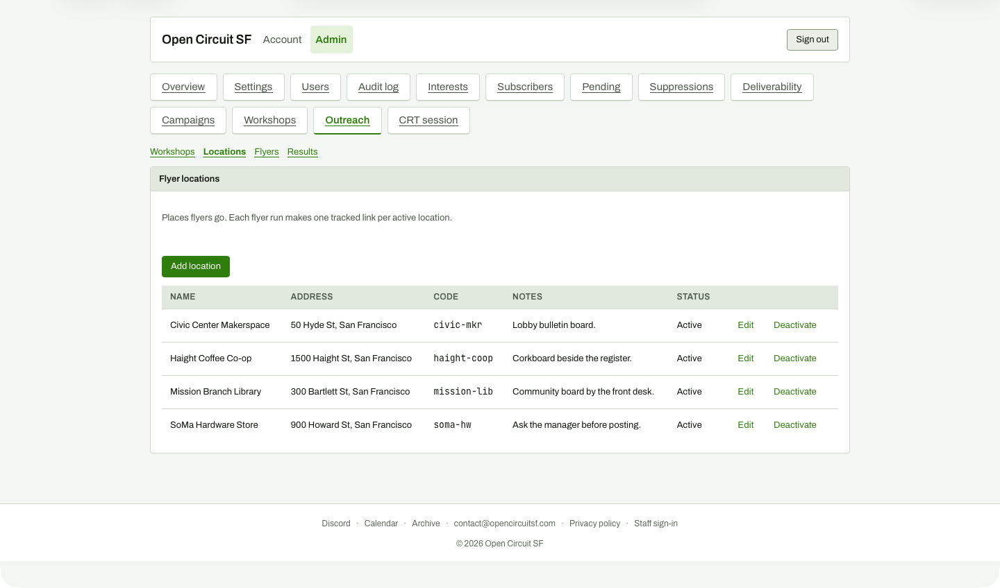

# Locations list

**Steps to reach it:** Outreach, Locations sub-tab.

**What the admin is trying to do:** Review flyer locations.

**Observations (candid):**

- Clear table with Edit / Deactivate. 'Deactivate' sits beside Edit as a plain link with no confirmation visible. 'Each flyer run makes one tracked link per active location' is the only explanation of why locations exist.
- There is a large empty gap above Add location (an empty paragraph).
