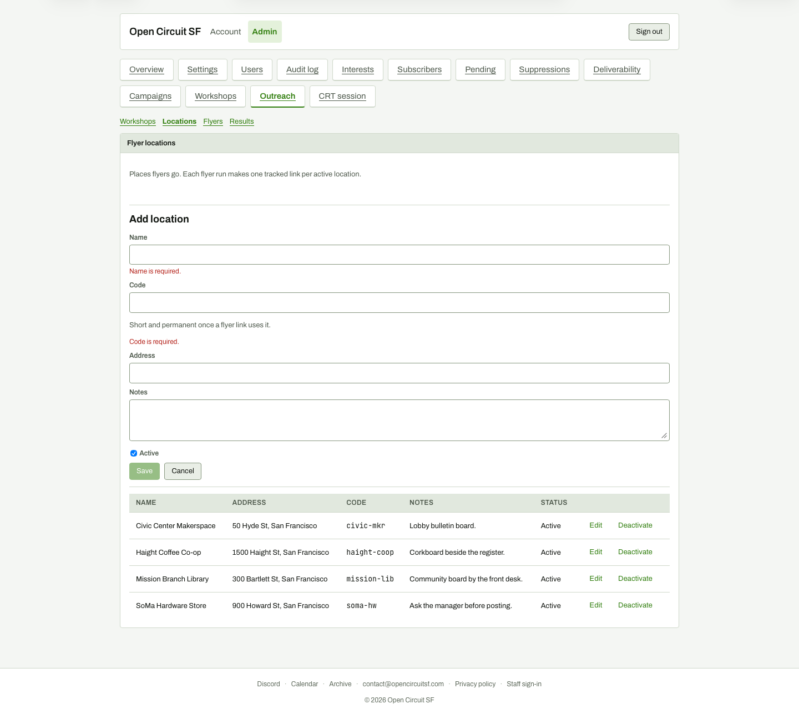

# Add location form

**Steps to reach it:** Click Add location.

**What the admin is trying to do:** Add a new flyer spot.

**Observations (candid):**

- Validation errors 'Name is required.' and 'Code is required.' show in red immediately, before the user has typed anything.
- Code is explained as 'Short and permanent once a flyer link uses it' with no format rules (letters? hyphens?) and no auto-suggestion from the name.
- Save stays disabled with no explanation beyond the red text. The form pushes the table down rather than opening in place.
