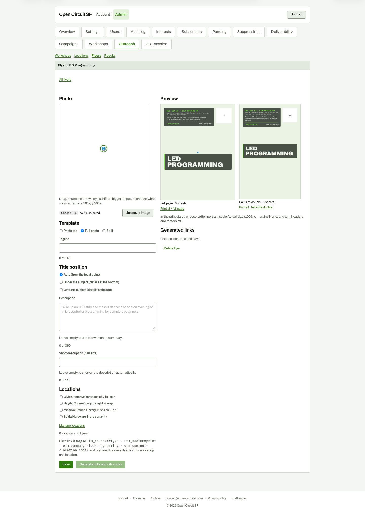

# Flyer editor (new flyer)

**Steps to reach it:** Click New flyer.

**What the admin is trying to do:** Design a flyer.

**Observations (candid):**

- The Photo box is empty with a broken-image marker (cover image 404s locally); the preview shows only the title block on green. Photo is the core of the flyer and there is no empty-state guidance beyond a drag hint.
- Left column is a long form (photo, template, tagline, title position, description, short description, locations); the previews are on the right and scroll out of view while you edit lower fields.
- Character counters ('0 of 140') sit below inputs with generous spacing.
- 'Generate links and QR codes' is disabled until you tick locations and Save; the dependency is not explained.
