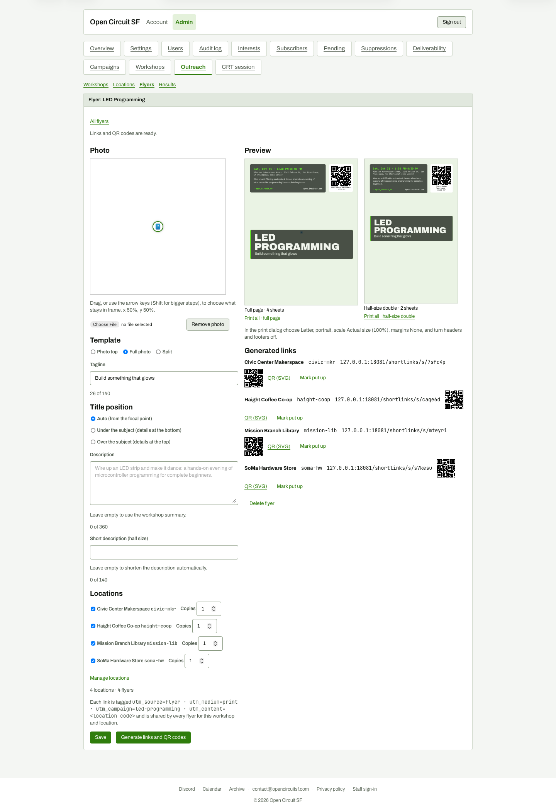

# Flyer editor after generating links

**Steps to reach it:** Add a tagline, click Use cover image, tick all four locations, Save, then Generate links and QR codes.

**What the admin is trying to do:** Get printable flyers.

**Observations (candid):**

- 'Links and QR codes are ready.' appears at the top, far from the button. Photo is still missing (404).
- Generated links list is ragged: QR codes alternate left/right alignment, 'QR (SVG)' and 'Mark put up' are plain links.
- Preview says '4 sheets' / '2 sheets' with no per-location copy count until you notice the Copies spinners that appeared in the Locations list.
