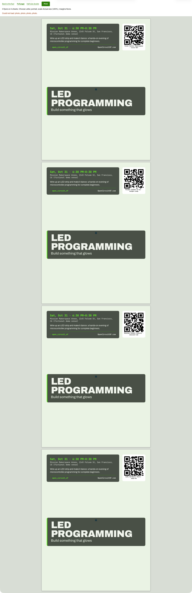

# Print view, full page (4 sheets)

**Steps to reach it:** Click 'Print all - full page'.

**What the admin is trying to do:** Print.

**Observations (candid):**

- Bare page with a tiny toolbar. 'Could not load: photo, photo, photo, photo.' in red is cryptic (one per sheet; it only means the cover image 404s locally).
- Without the photo each sheet is mostly empty green. Needs a clear 'no photo' state before printing.
- I did not run the browser print dialog.
