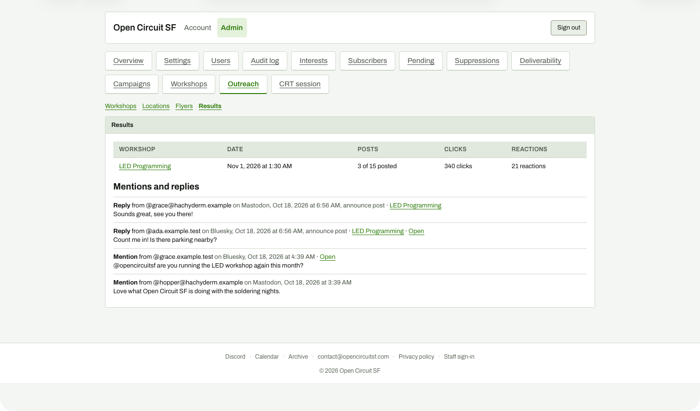

# Results overview

**Steps to reach it:** Outreach, Results sub-tab.

**What the admin is trying to do:** See how outreach is doing.

**Observations (candid):**

- Summary table: '3 of 15 posted', '340 clicks', '21 reactions'. '15' counts every channel slot including video channels never drafted, so '3 of 15' looks like a failure when only 3 manual/automatic posts were intended so far.
- Mentions and replies list: names, timestamps, 'announce post', 'Open' links (dead). Mentions are not tied to workshop unless matched.
- Reactions: 21 here vs '18 likes, 1 repost, 2 replies' (=21) on the detail page - consistent only if you add them up.
