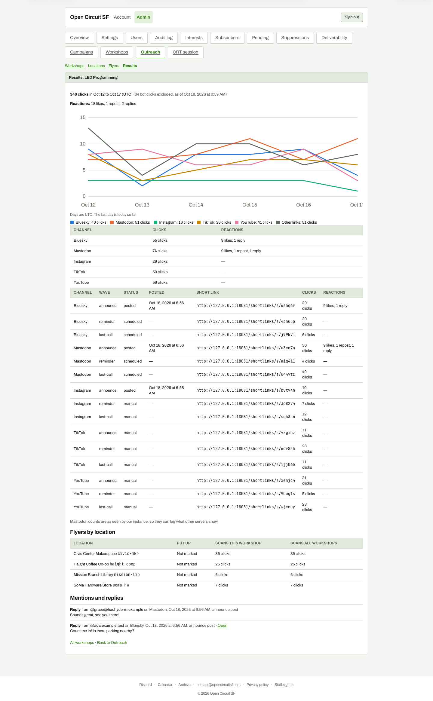

# Results for LED Programming (full page)

**Steps to reach it:** Click the workshop in Results.

**What the admin is trying to do:** Understand clicks per channel and flyer.

**Observations (candid):**

- Chart x-axis clips the last label ('Oct 17' is cut to 'Oct 1'). The data starts Oct 12, before any post (demo-generated), so the story is incoherent.
- Numbers disagree within the page: legend says 'Bluesky: 40 clicks', the table below says 55 and the link rows sum to 55.
- '34 bot clicks excluded', 'Days are UTC' and 'as of ...' notes are useful but tiny.
- Flyers by location shows 'Not marked' put up but clicks already scanned; 'Scans this workshop' and 'Scans all workshops' are identical.
- Page is very dense: summary, chart, channel table, 19-row link table, flyers, mentions.
