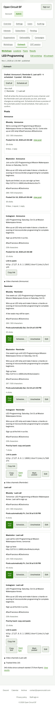

# 390 px: workshop outreach (full page, 4,920 px)

**Steps to reach it:** Resize window to 390 wide.

**What the admin is trying to do:** Same as desktop on a phone.

**Observations (candid):**

- Works without horizontal page scroll but is extremely long. The 13 tab buttons wrap into five rows pushing content far down.
- Action rows wrap awkwardly (Post now / Schedule / Unschedule / Edit in a cramped row, Open flyer link squeezed between buttons).
